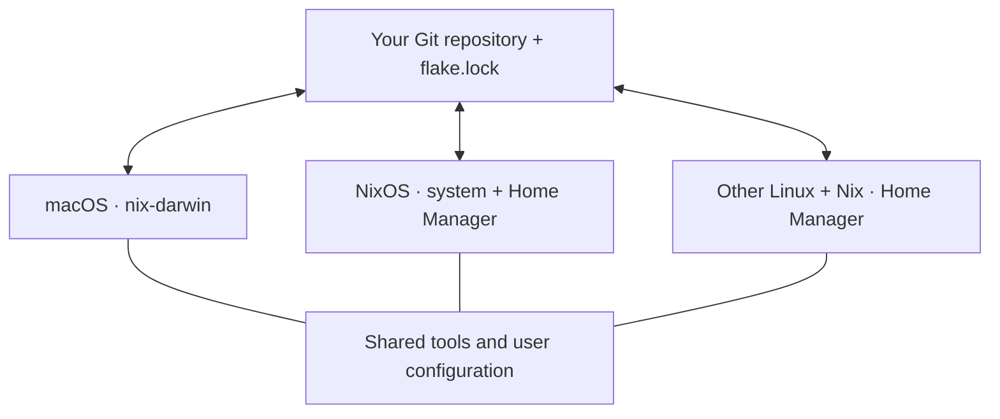

# Nix Sync

**One repository. macOS, NixOS, and Linux with Nix.**

Keep your command-line tools, shell, Git, and SSH settings in one shared configuration. Make a change on any device, push it, then pull and apply it on the others. Platform and machine differences stay in separate modules.

[中文](README.zh-CN.md) · [Configuration](flake.nix) · [Sync script](sync.sh)



This is a small reference template for sharing a Nix configuration across platforms. Synchronization runs when you request it. It covers declared tools and settings; documents, browser data, logins, and secrets are managed separately.

## Platforms

| Platform | Target | Managed scope |
| --- | --- | --- |
| Apple Silicon macOS | `macbook`, `macmini` | macOS settings + user tools and configuration |
| NixOS | `nixos` | System + user configuration; requires your existing machine settings |
| Other Linux with Nix, such as Ubuntu, Debian, Fedora, or Arch | `linux-x86_64`, `linux-aarch64` | User tools and configuration; the distribution keeps managing the OS |

The two Mac profiles are examples, not a device limit. Add profiles for more machines. The standalone Linux profiles target x86-64 and ARM64 GNU/Linux with Nix installed; this template does not claim support for every distribution or GUI application.

The shared baseline includes Git, ripgrep, fd, jq, tree, and Zsh. `flake.lock` pins the Nix inputs across devices. Different platforms build different packages from those inputs; they do not use identical binaries or identical OS settings.

## Layout

| File | Purpose |
| --- | --- |
| `modules/home.nix` | Tools and user configuration shared across all platforms |
| `modules/macos.nix` | Shared macOS system settings |
| `modules/nixos.nix` | Shared NixOS system settings |
| `hosts/macbook.nix`, `hosts/macmini.nix` | Mac-specific differences |
| `hosts/linux.nix` | Standalone Linux user configuration |
| `hosts/nixos/` | Your NixOS machine, disks, and boot configuration |
| `users.nix` | Existing account names for the example profiles |
| `flake.lock` | Shared dependency versions |

## Start with your own repository

Choose **Use this template → Create a new repository** on GitHub. A **private** repository is recommended for your personal configuration. Clone that same repository on every device:

```bash
git clone https://github.com/YOUR_USERNAME/YOUR_REPO.git ~/nix-sync
cd ~/nix-sync
```

Install Nix with flakes enabled on each device. See the [Nix installation guide](https://nix.dev/install-nix) and [nix-darwin prerequisites](https://github.com/nix-darwin/nix-darwin#prerequisites) for macOS. If needed, add `experimental-features = nix-command flakes` to `~/.config/nix/nix.conf`.

Run `id -un` on each device and edit the matching entry in `users.nix`. The accounts must already exist. Standalone Linux defaults to `/home/<username>`; change `home.homeDirectory` in `flake.nix` if your account uses a different location.

Already using nix-darwin or Home Manager? Merge the modules you need, preserve your existing `stateVersion` values, and back up files before adopting the template. Activation manages shell, Git, and SSH configuration files; macOS also changes machine names and a few Dock / Finder preferences. Inspect and migrate conflicting files instead of deleting them blindly.

### macOS and standalone Linux

After reviewing and staging your setup changes:

```bash
git add users.nix
./sync.sh check
git diff --cached
git commit -m "Configure my devices"
git push

# Choose ONE target matching this device:
./sync.sh build macbook
./sync.sh apply macbook
# Other examples: macmini, linux-x86_64, linux-aarch64
```

The macOS command prepares the locked `darwin-rebuild` and requests sudo for activation. Standalone Linux builds and activates Home Manager as your normal user, without sudo. It does not change your login shell automatically; run `zsh` to try the managed shell before changing that separately.

### NixOS

Use an existing working NixOS installation. Replace **the entire** `hosts/nixos/machine.nix` placeholder with your current machine configuration, and copy its `hardware-configuration.nix` and any relative imports alongside it. Preserve disks, bootloader, architecture, login access, networking, and `system.stateVersion`. Review copied files for private data before committing them to your own repository.

The default architecture is `x86_64-linux`. For ARM64, set `nixpkgs.hostPlatform = "aarch64-linux";` in your real machine configuration. If Home Manager is already integrated, merge the shared settings and avoid importing its module twice. Preserve your existing `home.stateVersion` as well.

The placeholder deliberately fails validation: the repository provides no generic disk layout to apply accidentally. After adapting and committing your real machine settings, run **on that NixOS machine**:

```bash
./sync.sh build nixos
./sync.sh apply nixos
```

The exported `nixosModules.default` can also be imported into an existing flake. In that case, adapt its username and shared settings to your configuration.

## Everyday cross-platform sync

For example, add a shared tool on a Mac, then receive it on Linux:

```bash
# On the Mac:
./sync.sh pull
# Edit home.packages in modules/home.nix.
git add modules/home.nix
./sync.sh check
git diff --cached
git commit -m "Add a shared tool"
./sync.sh apply macbook
git push
```

```bash
# On another device, choose its target:
./sync.sh sync linux-x86_64
# Or: ./sync.sh sync nixos
# Or: ./sync.sh sync macmini
```

The direction is symmetric: Linux can publish a change that the Mac receives. Once devices apply the same commit and lockfile, they use the same shared declarations and dependency inputs while retaining platform-specific settings. Add platform-only packages in the corresponding host module instead of the shared package list.

| Command | Effect |
| --- | --- |
| `./sync.sh pull` | Fetch and fast-forward from the configured upstream |
| `./sync.sh check` | Test sync behavior and evaluate the example configurations |
| `./sync.sh build HOST` | Build this device's configuration without applying it |
| `./sync.sh apply HOST` | Apply the current committed configuration; no pull or push |
| `./sync.sh sync HOST` | Pull, check, and apply |

Choose the target explicitly. The script checks OS, architecture, and username, but cannot infer your intended physical machine. Pull stops for uncommitted changes, untracked files, unpublished commits, divergent histories, or network failure. Inspect `git status` and `git log --oneline --graph --all -12`, then resolve the difference. There are no automatic commits, force pushes, resets, or stashes.

New Nix files must be added to Git before Nix can see them. Checks can run before committing; activation requires a clean working tree.

## Local secrets and dependency updates

Git reads `~/.config/nix-sync/gitconfig` for personal identity, and SSH reads `~/.ssh/config.local` for private hosts. See `examples/`; merge existing files instead of overwriting them. These runtime files and actual keys stay on each device. If you used the first Mac-only template, move your local Git identity file from `~/.config/nix-dual-mac/gitconfig` to the new path before applying this version.

Do not import secrets with `builtins.readFile`: generated content can enter the Nix store and be readable by other local users. `.gitignore` excludes common local secrets and databases, but cannot catch credentials pasted into ordinary configuration files or remove old Git history. Review staged changes and consider a [Gitleaks](https://github.com/gitleaks/gitleaks) scan before sharing.

Run `nix flake update` deliberately, review and commit `flake.lock`, then apply it on each device. Synchronization itself never updates dependencies. Keep `system.stateVersion` and `home.stateVersion` unchanged during routine upgrades; see the [Home Manager upgrade guide](https://nix-community.github.io/home-manager/usage/upgrading.html).

## What is verified

Checks evaluate both Mac profiles, both standalone Linux architectures, and the shared NixOS module using test-only hardware settings. `./sync.sh build nixos` checks your actual NixOS machine configuration. Git tests exercise synchronization failure handling; command-routing tests use mock tools and never activate an OS. GitHub Actions runs those shell tests.

This template has not been activated on real machines across all listed platforms. Build on each target before the first activation; distro-specific desktop integration may need additional configuration.

References: [Nix](https://nix.dev/) · [nix-darwin](https://github.com/nix-darwin/nix-darwin) · [Home Manager on NixOS](https://nix-community.github.io/home-manager/nix-flakes/nixos.html) · [Standalone Home Manager](https://nix-community.github.io/home-manager/nix-flakes/standalone.html)

MIT License.
