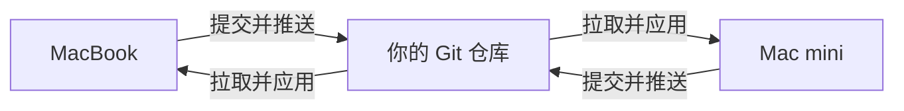

# nix-dual-mac

**两台 Mac，一份配置。** MacBook 上调整工具和终端设置，提交到自己的仓库；Mac mini 拉取同一份配置，再应用自己的机器设置。

[English](README.en.md) · [配置入口](flake.nix) · [同步脚本](sync.sh)



适合 **Apple Silicon MacBook + Mac mini**。Nix 固定软件依赖，nix-darwin 管理 macOS 配置，Home Manager 管理用户工具和终端配置。两台机器可以使用不同的 macOS 用户名。

这是从个人双端配置流程提炼出的精简模板。它同步的是**你明确写进配置的工具和设置**；文件、浏览器数据、登录状态和密钥仍由各台机器自己管理。同步由你运行命令触发。

## 共用什么，分别改什么

| 文件 | 用途 |
| --- | --- |
| `modules/macos.nix` | 两台共用的系统设置 |
| `modules/home.nix` | 两台共用的软件、Zsh、Git、SSH 配置 |
| `hosts/macbook.nix` | MacBook 名称及专属设置 |
| `hosts/macmini.nix` | Mac mini 名称及专属设置 |
| `users.nix` | 两台机器各自已有的 macOS 用户名 |
| `flake.lock` | 两台共用的依赖版本，随配置一起提交 |

初始配置只包含 Git、ripgrep、fd、jq、tree、Zsh，以及少量 Dock / Finder 设置。可以逐步添加自己的软件。模板不会安装 Homebrew，也不包含服务器部署配置。

## 第一次使用

### 准备自己的仓库

点击 GitHub 的 **Use this template → Create a new repository**，建议将自己的配置仓库设为 **Private**。两台 Mac 都克隆你的仓库，不要一台使用模板仓库、另一台使用个人仓库。

```bash
git clone https://github.com/YOUR_USERNAME/YOUR_REPO.git ~/nix-dual-mac
cd ~/nix-dual-mac
```

两台 Mac 都需要安装支持 flakes 的 Nix；安装方式和已有系统迁移请先阅读 [nix-darwin 官方说明](https://github.com/nix-darwin/nix-darwin#prerequisites)。如果 Nix 提示实验功能未启用，在 `~/.config/nix/nix.conf` 中添加 `experimental-features = nix-command flakes`。

如果已有 nix-darwin / Home Manager 配置，请合并需要的模块，保留原有 `stateVersion`。这个模板会接管相应的 shell、Git、SSH 配置文件，并更改电脑名称和少量系统偏好；先备份已有文件。遇到文件冲突应检查并迁移原文件，再重试。

### 填写两台机器的用户名

分别运行 `id -un`，将结果填入 `users.nix`。账号必须已经存在；脚本不会创建 macOS 账号。按需修改 `hosts/` 中的电脑名称。

```nix
{
  macbook = "your-laptop-account";
  macmini = "your-desktop-account";
}
```

在第一台机器检查并保存修改。新加的 Nix 文件需要先 `git add`，Nix 才能读取它们。

```bash
git add users.nix hosts/macbook.nix hosts/macmini.nix
./sync.sh check
git diff --cached
git commit -m "Configure my two Macs"
git push
./sync.sh apply macbook
```

首次应用会从锁定的依赖中准备 `darwin-rebuild`，然后请求 sudo 权限应用配置。第二台机器克隆同一个仓库后运行：

```bash
./sync.sh sync macmini
```

`macbook` / `macmini` 是配置名称，需要明确选择。脚本还会核对当前系统和用户名，但无法替你判断拿到的是哪台实体机器。

## 日常双端同步

**在任一台修改，提交后上传；在另一台拉取并应用。** 例如在 MacBook 上添加一个两台都要用的工具：

```bash
./sync.sh pull
# 编辑 modules/home.nix 中的 home.packages
git add modules/home.nix
./sync.sh check
git diff --cached
git commit -m "Add a shared tool"
./sync.sh apply macbook
git push
```

然后在 Mac mini 上：

```bash
./sync.sh sync macmini
```

反过来操作完全一样，应用时选择对应的机器。两台都应用了同一个 Git 提交和 `flake.lock` 后，共用配置及 Nix 依赖版本就一致了；`hosts/` 中的机器差异仍然保留。

| 命令 | 做什么 |
| --- | --- |
| `./sync.sh pull` | 拉取上游配置；不应用系统设置 |
| `./sync.sh check` | 检查文件、测试同步保护、检查两台的 Nix 配置；不构建系统 |
| `./sync.sh build macbook` | 构建该机器的配置；不应用 |
| `./sync.sh apply macbook` | 应用当前已提交的配置；不拉取、不上传 |
| `./sync.sh sync macmini` | 先拉取，再检查并应用 |

同步遇到未提交文件、未上传的本地提交、双方各自新增的提交或网络错误时会停止。先用 `git status` 和 `git log --oneline --graph --all -12` 看清差异，再提交、上传或手动合并。脚本不自动提交，不强制推送，也不删除本地修改。不要为了绕过错误直接复制 `git reset --hard`。

## 私人信息留在本机

Git 身份在每台机器的 `~/.config/nix-dual-mac/gitconfig` 中填写，SSH 主机在 `~/.ssh/config.local` 中填写。首次设置时参考 `examples/`，已有文件应合并而不是覆盖。实际密钥仍放在 `~/.ssh/` 或密码管理器中。

这些路径由 Git / SSH 在运行时读取，文件内容不会导入 Nix 配置。不要用 `builtins.readFile` 把密码或 Token 写进 Nix：生成内容可能进入可被本机其他用户读取的 Nix store。

`.gitignore` 已排除 `private/`、`.env`、常见密钥和数据库文件。**它不能检测写进普通配置文件的密钥，也不能清除已经提交的历史。** 分享前检查 `git diff --cached`；需要扫描时可使用 [Gitleaks](https://github.com/gitleaks/gitleaks)。

## 更新和验证

升级依赖是单独的操作，不会在日常同步时偷偷执行：

```bash
nix flake update
git add flake.lock
./sync.sh check
git diff --cached
git commit -m "Update locked dependencies"
./sync.sh apply macbook
git push
# 然后在另一台运行 ./sync.sh sync macmini
```

`system.stateVersion` / `home.stateVersion` 是兼容性设置，日常更新不要跟着改。详情见 [Home Manager 升级说明](https://nix-community.github.io/home-manager/usage/upgrading.html)。

本模板发布前已检查两台机器的 Nix 配置，并用本地 Git 仓库测试同步和错误保护。没有在真实机器上应用这套精简模板；首次使用请先运行 `./sync.sh build <机器>`，再应用。

依赖与实现参考：[Nix](https://nix.dev/) · [nix-darwin](https://github.com/nix-darwin/nix-darwin) · [Home Manager](https://nix-community.github.io/home-manager/)

MIT License.
