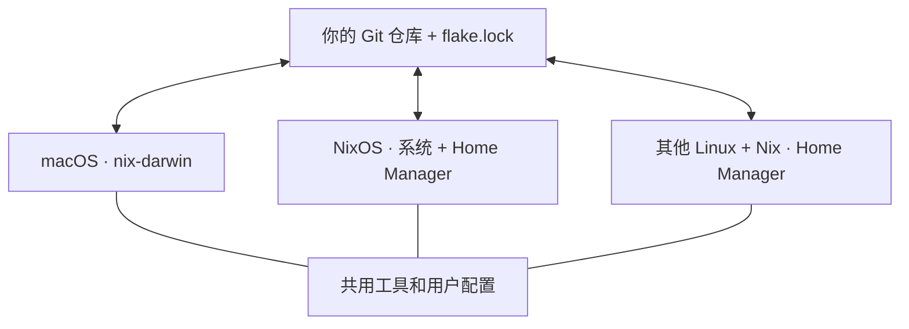

# Nix Sync

**一个仓库，同步 macOS、NixOS，以及安装了 Nix 的其他 Linux。**

命令行工具、Shell、Git 和 SSH 设置共用一份配置。在任一设备修改并上传，其他设备拉取后应用；不同系统和不同机器需要的设置分别保留。

[English](README.md) · [配置入口](flake.nix) · [同步脚本](sync.sh)



这是一个跨平台配置参考模板。同步由你运行命令触发，管理的是明确写进配置的工具和设置；个人文件、浏览器数据、登录状态和密钥另外管理。

## 支持哪些平台

| 平台 | 配置名称 | 管理范围 |
| --- | --- | --- |
| Apple Silicon macOS | `macbook`、`macmini` | macOS 设置、用户工具和配置 |
| NixOS | `nixos` | 系统和用户配置；需接入本机原有设置 |
| 安装了 Nix 的其他 Linux，例如 Ubuntu、Debian、Fedora、Arch | `linux-x86_64`、`linux-aarch64` | 用户工具和配置；原发行版继续管理操作系统 |

两台 Mac 只是示例，不是设备数量上限。可以添加更多机器。独立 Linux 配置面向安装了 Nix 的 x86-64 / ARM64 GNU/Linux，并不意味着所有发行版和图形软件都无需适配。

公共配置包含 Git、ripgrep、fd、jq、tree 和 Zsh。所有设备共用 `flake.lock` 固定依赖来源和版本；不同平台会生成各自的软件，不会强求系统设置或二进制文件完全一样。

## 配置放在哪里

| 文件 | 用途 |
| --- | --- |
| `modules/home.nix` | 全平台共用的工具和用户配置 |
| `modules/macos.nix` | macOS 共用系统设置 |
| `modules/nixos.nix` | NixOS 共用系统设置 |
| `hosts/macbook.nix`、`hosts/macmini.nix` | 各台 Mac 的差异 |
| `hosts/linux.nix` | 独立 Linux 用户配置 |
| `hosts/nixos/` | NixOS 本机、磁盘和启动设置 |
| `users.nix` | 各示例配置对应的现有用户名 |
| `flake.lock` | 共用的依赖版本记录 |

## 准备自己的仓库

点击 GitHub 的 **Use this template → Create a new repository**。个人配置仓库建议设为 **Private**。所有设备克隆同一个仓库：

```bash
git clone https://github.com/YOUR_USERNAME/YOUR_REPO.git ~/nix-sync
cd ~/nix-sync
```

每台设备需要安装并启用 flakes 的 Nix。参考 [Nix 安装说明](https://nix.dev/install-nix)；macOS 另见 [nix-darwin 前置条件](https://github.com/nix-darwin/nix-darwin#prerequisites)。如有需要，在 `~/.config/nix/nix.conf` 中添加 `experimental-features = nix-command flakes`。

分别运行 `id -un`，填写 `users.nix` 中对应的用户名。账号必须已经存在。独立 Linux 默认使用 `/home/<用户名>`；目录不同时，修改 `flake.nix` 中的 `home.homeDirectory`。

已经在用 nix-darwin 或 Home Manager 时，应合并需要的模块，保留原有 `stateVersion`，并先备份文件。模板会管理 Shell、Git、SSH 配置；macOS 还会更改机器名称和少量 Dock / Finder 设置。遇到文件冲突，检查并迁移已有文件后再重试。

### macOS 和其他 Linux

填写并检查配置后：

```bash
git add users.nix
./sync.sh check
git diff --cached
git commit -m "Configure my devices"
git push

# 选择当前机器对应的一种配置：
./sync.sh build macbook
./sync.sh apply macbook
# 其他示例：macmini、linux-x86_64、linux-aarch64
```

macOS 会准备锁定版本的 `darwin-rebuild`，应用时请求 sudo。独立 Linux 使用普通用户构建和应用 Home Manager，不使用 sudo，也不会自动更改登录 Shell；可以先运行 `zsh` 体验，再单独决定是否更换。

### NixOS

从已经正常工作的 NixOS 安装开始。用现有机器配置**完整替换** `hosts/nixos/machine.nix`，同时将它引用的 `hardware-configuration.nix` 和其他相对路径文件放到对应位置。保留真实的磁盘、启动方式、处理器架构、登录权限、网络及 `system.stateVersion`。复制的文件需要检查私人信息，再提交到自己的仓库。

默认架构为 `x86_64-linux`。ARM64 机器应在本机配置中设置 `nixpkgs.hostPlatform = "aarch64-linux";`。已有 Home Manager 配置时，需要合并公共设置，避免重复导入模块，同时保留自己的 `home.stateVersion`。

占位配置会主动报错，因此不能误把模板中的磁盘设置应用到真实机器上。接入并提交本机配置后，在对应的 NixOS 机器运行：

```bash
./sync.sh build nixos
./sync.sh apply nixos
```

也可以将导出的 `nixosModules.default` 接入已有 flake，并调整其中的用户名和公共设置。

## 日常跨平台同步

例如在 Mac 添加所有平台都要用的工具，再同步给 Linux：

```bash
# Mac 上：
./sync.sh pull
# 编辑 modules/home.nix 中的 home.packages
git add modules/home.nix
./sync.sh check
git diff --cached
git commit -m "Add a shared tool"
./sync.sh apply macbook
git push
```

```bash
# 其他设备选择自己的配置：
./sync.sh sync linux-x86_64
# 或 ./sync.sh sync nixos
# 或 ./sync.sh sync macmini
```

方向可以反过来：Linux 上的修改也能同步给 Mac。各设备应用同一提交和锁定文件后，公共配置及依赖来源保持一致，平台专属设置仍然保留。只适合某个平台的软件，应写在相应的机器模块里。

| 命令 | 做什么 |
| --- | --- |
| `./sync.sh pull` | 从对应远端分支拉取配置 |
| `./sync.sh check` | 测试同步保护并检查各平台示例配置 |
| `./sync.sh build HOST` | 构建当前设备的配置，不应用 |
| `./sync.sh apply HOST` | 应用当前已提交配置，不拉取、不上传 |
| `./sync.sh sync HOST` | 拉取、检查并应用 |

`HOST` 需明确选择。脚本核对操作系统、架构和用户名，但不会替你判断目标是哪台实体机器。有未提交或未追踪文件、未上传的本地提交、双方各自修改或网络错误时，同步会停止。先用 `git status` 和 `git log --oneline --graph --all -12` 查看，再处理差异。脚本不自动提交、强制推送、删除或暂存你的修改。

新 Nix 文件要先加入 Git，Nix 才能读取。检查可以在提交前运行，应用则要求工作目录没有待提交内容。

## 私人信息与依赖更新

Git 从本机的 `~/.config/nix-sync/gitconfig` 读取个人身份，SSH 从 `~/.ssh/config.local` 读取私人主机配置。参考 `examples/`，已有文件应合并而不是覆盖；这些文件和密钥留在各自设备上。如果使用过最初的 Mac 模板，请在应用新版前，将本机 Git 身份文件从 `~/.config/nix-dual-mac/gitconfig` 移至新路径。

不要通过 `builtins.readFile` 导入密钥，否则内容可能进入可被其他本机用户读取的 Nix store。`.gitignore` 已排除常见本地密钥和数据库，但不能检测普通配置里的密码，也不能清理旧 Git 历史。分享前检查提交内容，需要时运行 [Gitleaks](https://github.com/gitleaks/gitleaks)。

升级依赖时单独运行 `nix flake update`，检查并提交 `flake.lock`，再在各台设备应用。日常同步不会自动升级依赖。不要随更新改动 `system.stateVersion` 或 `home.stateVersion`，详见 [Home Manager 升级说明](https://nix-community.github.io/home-manager/usage/upgrading.html)。

## 验证范围

配置检查覆盖两种 Mac 示例、两种独立 Linux 架构，以及使用专门测试配置的公共 NixOS 模块。真实 NixOS 机器仍需运行 `./sync.sh build nixos` 检查自己的硬件设置。Git 测试覆盖同步错误保护；命令分发测试使用模拟工具，不会应用系统。GitHub Actions 运行这些 Shell 测试。

没有在所有列出的平台上实际应用此模板。首次使用请在目标设备上先构建再应用；不同发行版的桌面集成可能还需要调整。

参考：[Nix](https://nix.dev/) · [nix-darwin](https://github.com/nix-darwin/nix-darwin) · [NixOS 的 Home Manager](https://nix-community.github.io/home-manager/nix-flakes/nixos.html) · [独立 Home Manager](https://nix-community.github.io/home-manager/nix-flakes/standalone.html)

MIT License.
